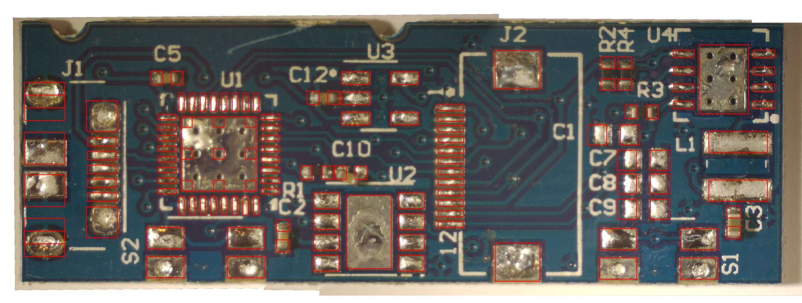
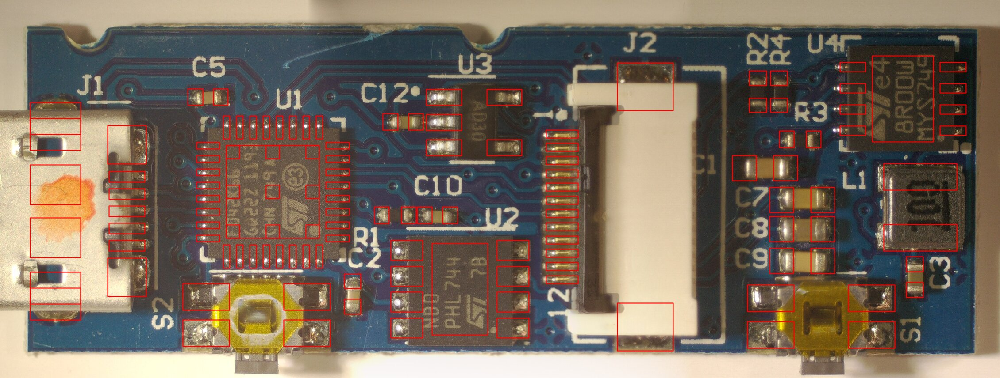
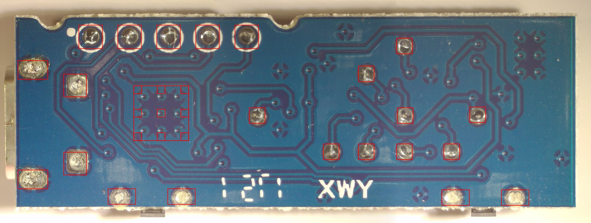
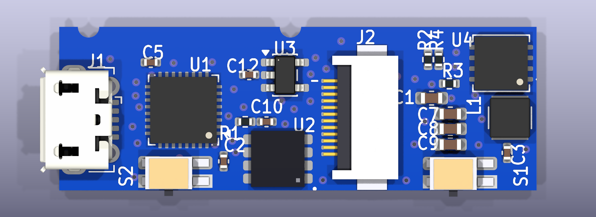
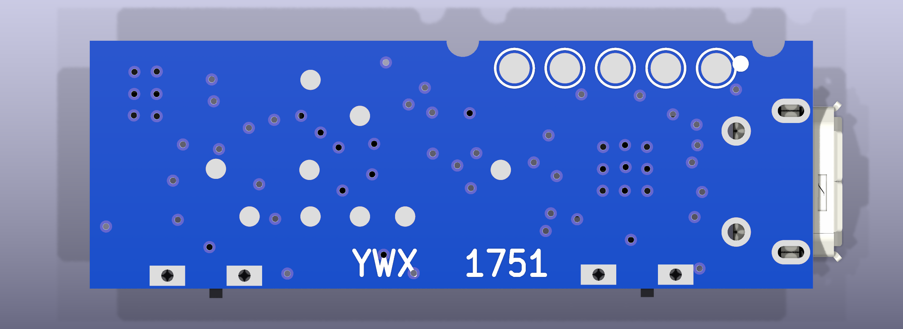
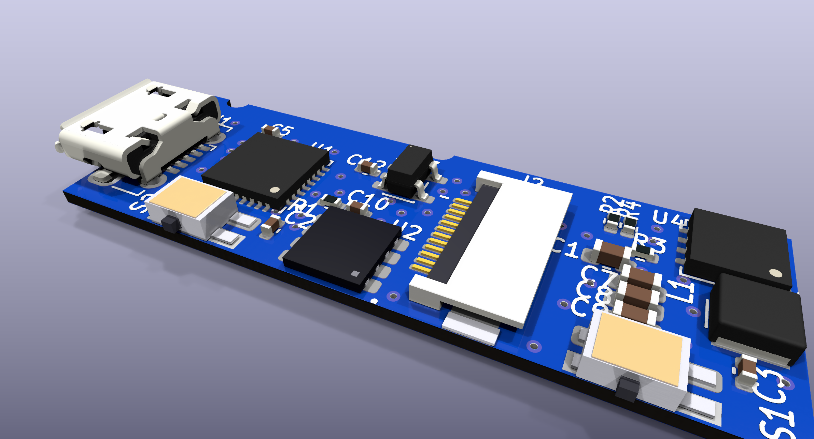
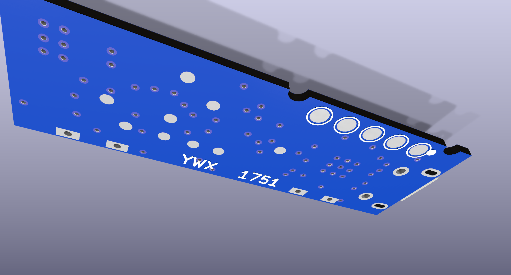

# KiCad reconstruction

The project is in [`kicad/`](../kicad/) (KiCad 10). Open
`kicad/ledger_nano_s.kicad_pro`.

## What is in it

| Item | State |
|------|-------|
| Board outline | 35.66 × 12.27 mm, with the two clip notches on the top edge. Measured from photos (about ±1%). |
| Footprints | All 31 parts (U1–U4, J1, J2, L1, S1, S2, 9 caps, 4 resistors, 14 back-side test pads) are placed at their measured positions. Accuracy is about ±0.2 mm. |
| Photo underlays | The stitched front photo is on layer **User.1**, the mirrored back photo on **User.2**, and the front with components removed on **User.3** (best for tracing top copper). All three are scaled and aligned to the board outline and locked. Toggle them in the Layers panel to trace copper. |
| Schematic | All symbols, linked to their footprints (F8 / "Update PCB from schematic" works). Nets are attached with labels. |
| Nets | Traced from the photos and the hand-drawn trace layers in `pics/20261112_183853.xcf` (front) and `pics/back_aligned.xcf` (back) (see [tracing.md](tracing.md)). They cover USB, power, the SWD header, the OLED connector, the boost converter, the SE link and S2. |
| Tracks / vias | 62 vias are placed with nets. No tracks yet. |

Overlay check (the red boxes are the KiCad pad positions drawn on the
photos):

## 3D renders

Regenerate with `tools/render_3d.py`, which renders a copy of the board with
the photo underlays stripped.

- Board: **0.8 mm** FR4, blue mask, white silkscreen, HASL finish (stackup in
  the board file).
- Silkscreen reference labels are placed where they are printed on the real
  board (measured on the photo), including the back `YWX 1751` and the
  header pin-1 dot.
- Custom VRML models (`kicad/ledger_nano_s.3dshapes/`) are simple coloured
  boxes sized from the photos: U2 (DFN8 4.0×4.2), J2 (flip-lock FPC with
  white actuator) and S1/S2 (side-push switch, metal frame and Kapton top,
  plunger past the board edge, body offset about 0.5 mm from the land centre).
- KiCad 10 doesn't ship the models for these stock footprints, so the
  closest shipped model is used instead: U1 → QFN-32 5×5, U4 → DFN-8 4×4
  (EP 2.5×3.6), L1 → 3×3 mm FNR3012S, J1 → Molex 47346 micro-B (instead of
  105017).

## Nets entered so far

The nets come from photo tracing. See [tracing.md](tracing.md) for the
evidence and the confidence of each one. Summary:

- **SWD header (back):** TP1 +3V0, TP2 SWCLK, TP3 GND, TP4 SWDIO, TP5 NRST
- **USB:** J1 D−/D+ → U1 PA11/PA12
- **Power:** VBUS → U3 (LDO: 1 = VIN, 3 = EN, 2 = GND, 5 = VOUT) → +3V0.
  VBUS → L1 → U4.1 (boost switch node). U4.8 → J2.1 (panel VCC). R3/R4
  divider → U4.5.
- **OLED (J2):** SPI1 (PA5 SCK → J2.8, PA7 MOSI → J2.9), GPIOs PA0/PA1/PA2
  → J2.7/5/6, +3V0 → J2.4, C7/C8/C9/R2 on J2.10–12
- **SE link:** U2.3 → PA9 (I/O), U2.5 → PA8 (CLK), U2.6 → PA10, U2.7 = +3V0 (USART1 smartcard wiring)
- **Buttons:** S2 → PA15, S1 → PB7
- 62 vias are placed with nets. Tracks are still unrouted (only the ratsnest
  is shown).

## Footprint choices / assumptions

- **U1** `UFQFPN-32-1EP_5x5mm_P0.5mm_EP3.5x3.5mm`, rotated 180°.
  Pin 1 is at the package dot (bottom-right in the photos), so PA11/PA12
  face the USB connector. The plain footprint (no built-in thermal vias) is
  used, because the 3×3 EP vias are placed as board vias.
- **U2** custom `ST_DFN8-1EP_4.0x4.2mm_P0.98mm`, measured on the bare
  board: 8 pads 1.2 x 0.75 mm, pitch 0.98 mm, columns 4.0 mm apart, plus a
  2.1 x 3.45 mm **exposed pad** (pin 9, no vias, net unknown). The body is
  4.0 x 4.2 mm. Pin 1 is at the dot (bottom-right on the board), numbered
  counter-clockwise. The removed chip, held upright, has the usual ST dot at
  the bottom-left.
- **U3** `SOT-23-5`, pin 1 at the silkscreen dot (top-left).
- **U4** `DFN-8-1EP_4x4mm_P0.8mm_EP2.3x3.24mm` (ST8R00 is DFN8 4×4),
  rotated 180° (dot at bottom-right). The pin functions in its symbol are
  still placeholders.
- **J1** `USB_Micro-B_Molex-105017-0001`. Its THT shell legs (oval pair
  7.0 mm apart, square pair 5.0 mm apart) match the back photo.
- **J2** custom `FPC_12P_P0.5mm_Pin1Top`, 0.5 mm pitch, mounting tabs at
  +-4.54 mm (same spacing as Hirose FH12-12S, but the pin numbering is
  reversed). Pin 1 is at the top to match the board silkscreen.
- **S1/S2** custom `SW_SideTact_P3.8x1.38mm`: 4 pads 1.75 x 1.0 mm. The pair
  on the board-edge side is plated through (they show on the back).
- **L1** `L_Abracon_ASPI-3012S` rotated 90 degrees. The bare board shows its
  two pads are horizontal bars, one above the other.
- **TP1–TP5** = the ringed 5-pad header on the back (TP1 = dot end). TP6–TP14
  are the other solder-bumped back pads.
- Passive values are unknown (`C?`, `R?`). L1 is 10 µH (marking `100`).

## Regenerating

`tools/gen_kicad.py` built the initial project from the measurements. It
**overwrites** the schematic and PCB. From now on, edit in KiCad directly and
only re-run the script to start over.

## Known caveats

- DRC/ERC report many violations: unrouted nets, unknown pins, and stock
  footprints sitting closer to the edge than the default rules allow. This
  is expected at this stage.
- The image scale assumes KiCad sizes the embedded photos at 300 PPI. If the
  photo layers don't line up with the outline when the board is opened in
  the GUI, adjust the image scale (properties of the image) to 0.1969.
